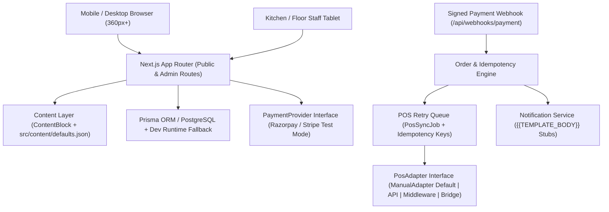

# Caffè & Tè — All Day Cafe (Website, Ordering, Reservation & Sanity CMS)

Full-stack, mobile-first (`360px+`) website, online ordering, table reservation, and Sanity Studio CMS platform for **Caffè & Tè — All Day Cafe** (`कैफे & ते - ऑल डे कैफे`) & **Pasta Social by Caffè & Tè** in Viman Nagar, Pune.

---

## 1. Quick Start (`npm run dev`)

```bash
# 1. Install dependencies
npm install

# 2. Copy environment template (optional for local dev; seeded fallback is built-in)
cp .env.example .env.local

# 3. Generate Prisma Client
npm run db:generate

# 4. Run development server (http://localhost:3000)
npm run dev
```

### Optional Database Commands (when PostgreSQL is attached)
```bash
npm run db:push   # Push Prisma schema to PostgreSQL
npm run db:seed   # Run dev-only seed script (refuses to run in production)
```

### Verification & Quality Commands
```bash
npm run typecheck # TypeScript strict check
npm run lint      # Next.js ESLint check
npm test          # Vitest automated test suite (RBAC, webhooks, POS idempotency, validation)
```

---

## 2. Architecture Diagram & Technical Trade-Offs



### Key Architectural Trade-Offs
1. **Content-Agnostic Token Layer (`src/lib/content.ts` + `src/content/defaults.json`)**:
   - Every string resolves through `t('namespace.section.field')` to an explicit `{{SECTION_FIELD}}` placeholder token, and every image slot resolves through `getImageSlot(slot, aspect)` to `/placeholders/{aspect}.svg`. Final copy and photography can be dropped in via `src/content/defaults.json` or `/admin/content` with zero component code changes.
2. **Webhook as Single Source of Truth for Payments (`/api/webhooks/payment`)**:
   - Online orders start in `placed` status with `paymentStatus = PENDING`. Only a signature-verified, replay-protected call to `POST /api/webhooks/payment` transitions an order to `paid` and triggers the kitchen POS push.
3. **POS Adapter Pattern + Idempotent Queue (`src/lib/pos/adapter.ts`)**:
   - Because the restaurant's exact POS vendor is TBD (PRD §10 & §19.1), `ManualPosAdapter` (printable KOT + tablet board) ships active by default while `ApiPosAdapter`, `MiddlewarePosAdapter`, and `BridgePosAdapter` are wired behind the same `PosAdapter` interface and switchable at `/admin/integrations/pos`. Every push uses a deterministic `pos-idem-${order.id}` idempotency key so no order is ever billed twice.
4. **Zero-Config Local Dev Fallback (`src/lib/db.ts`)**:
   - While `prisma/schema.prisma` defines all 36 PostgreSQL models/enums and `prisma/seed.ts` seeds PostgreSQL, `src/lib/db.ts` also maintains a seeded in-memory store so `npm run dev` works immediately out-of-the-box before a Postgres instance is provisioned.

---

## 3. Folder Structure

```text
caffe-te/
├── .github/workflows/ci.yml          # GitHub Actions CI pipeline
├── prisma/
│   ├── schema.prisma                 # 36 models/enums (PRD §11.3)
│   └── seed.ts                       # Dev-only seed script
├── public/placeholders/              # Aspect-ratio SVGs (16x9, 4x3, 1x1, 3x4)
├── src/
│   ├── __tests__/                    # Automated Vitest tests
│   ├── content/defaults.json         # Namespaced {{SECTION_FIELD}} dictionary
│   ├── components/
│   │   ├── ui/                       # PRD §5.9 design system primitives
│   │   ├── layout/                   # Header, Footer, AnnouncementBar, MobileBottomBar, CartBottomSheet, WhatsAppFab, ConsentBanner
│   │   ├── sections/                 # HomeSections, MenuCatalog
│   │   ├── admin/                    # AdminShell, PermissionGuard (PRD §9.9)
│   │   └── seo/                      # JSON-LD SchemaMarkup & Consent-aware AnalyticsTracker
│   ├── lib/
│   │   ├── content.ts                # Content key & image slot resolver
│   │   ├── seed-data.ts              # Structured placeholder seed records & live IST hours check
│   │   ├── cart-context.tsx          # Persisted cart state
│   │   ├── db.ts                     # Prisma singleton + runtime store
│   │   ├── auth/rbac.ts              # PRD §9.9 Role Permission Matrix
│   │   ├── validations/schemas.ts    # Shared client/server Zod schemas
│   │   ├── security/spam-guard.ts    # Honeypot & sliding-window rate limiter
│   │   ├── payments/provider.ts      # Razorpay/Stripe test provider & HMAC verification
│   │   ├── notifications/service.ts  # {{TEMPLATE_BODY}} notification dispatcher & logger
│   │   └── pos/adapter.ts            # PosAdapter interface, ManualAdapter, stubs & retry queue
│   └── app/
│       ├── (public)/                 # All 17 public routes (PRD §6.1)
│       ├── admin/                    # All 15 admin routes (PRD §6.2)
│       └── api/                      # Public, Webhook, SSE & POS Bridge endpoints (PRD §11.4)
```

---

## 4. Where to Add Final Content (Content Hand-Off Guide — PRD §15)

| Content Type | Where to Update |
|---|---|
| **Copy, Taglines, Phone, WhatsApp, Address, Legal Text** | Edit `src/content/defaults.json` OR live-edit via `/admin/content` (`ContentBlock` editor). |
| **Photography & Media Slots** | Replace SVGs in `public/placeholders/` or map slot names in `src/lib/content.ts` (`getImageSlot`) / `/admin/gallery`. |
| **Menu Categories, Dishes, Prices, Variants, Allergens** | Edit `src/lib/seed-data.ts` (`SEED_CATEGORIES`, `SEED_MENU_ITEMS`) or manage via `/admin/menu` and `/admin/inventory`. |
| **Opening Hours & Holiday Overrides** | Edit `SEED_OPENING_HOURS` in `src/lib/seed-data.ts` or toggle live via `/admin/content`. |
| **Offers, Happy Hours & Events** | Edit `SEED_OFFERS` / `SEED_EVENTS` in `src/lib/seed-data.ts` or manage via `/admin/offers`. |

---

## 5. What Is Built vs. Stubbed (PRD Section 13 Checklist)

- **Fully Built in Skeleton**:
  - Design tokens (`#0F0F10`, `#1A1815`, `#FFF4E0`, `#D9C7A8`, `#E8B547`→`#C98A2B`, `#B3202A`), glow system, `Cormorant Garamond` + `DM Sans` fonts, and all PRD §5.9 UI components.
  - All 17 public pages (PRD §6.1) and all 15 admin pages (PRD §6.2) with the PRD §9.9 RBAC permission matrix.
  - Full Prisma PostgreSQL schema (PRD §11.3) and dev seed script (`prisma/seed.ts`).
  - End-to-end Reservation flow, Online Ordering + Bottom-Sheet Cart + Checkout + SSE Order Tracking, HMAC-verified idempotent Payment Webhook (`/api/webhooks/payment`), and `ManualPosAdapter` with idempotent retry queue.
  - JSON-LD Schema markup, `sitemap.xml`, `robots.txt`, Zod validation, honeypot + rate limiting, consent-aware analytics, and automated tests.
- **Explicitly Stubbed Behind Interfaces (Pending External Vendor Keys / Decisions in PRD §19)**:
  - `ApiPosAdapter`, `MiddlewarePosAdapter`, and `BridgePosAdapter` in `src/lib/pos/adapter.ts` (`TODO(PRD-19.1)`: awaiting confirmation of the restaurant's POS vendor/version).
  - Live Razorpay / Stripe SDK credentials in `.env.example` (`PAYMENT_TEST_MODE="true"` used in skeleton).
  - Live Email (Resend/SES), SMS (MSG91/Twilio), and WhatsApp Cloud API credentials in `src/lib/notifications/service.ts` (logs `{{TEMPLATE_BODY}}` to `NotificationLog` in skeleton mode).
  - Staging HTTPS deployment (`TODO`: ready to deploy to Vercel + Neon/Supabase once domain and cloud accounts in PRD §19.6 are provisioned).

